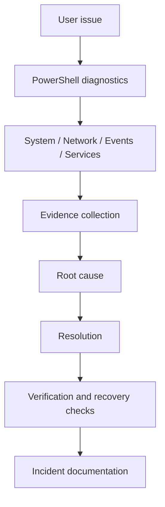

# IT Support Operations Lab — Windows Diagnostics, Networking & Backup

A PowerShell toolkit and practical lab for investigating Windows workstation issues, preserving evidence, and verifying recovery. It combines read-only diagnostics, isolated backup/restore tests, guided incident exercises and a concise troubleshooting knowledge base.

No captured workstation evidence ships with the project. Incident files are unexecuted exercises with fields for actual observations. Screenshots and diagnostic results must come from your own runs.



## Capabilities

- OS/build, boot time, uptime, CPU, memory, mounted fixed volumes and top processes.
- Adapter/link status, IPv4 addressing, gateway, DNS, DHCP, ICMP and TCP probes.
- Recent critical/error events, stopped automatic services and Windows Update service state.
- SHA-256 comparisons of original, backup and restored files without deleting originals.
- TXT, structured JSON, CSV evidence and a self-contained local HTML summary.
- Optional report redaction, eight guided incidents and six practical KB articles.

## Requirements

Windows 11 is the recommended lab environment. Scripts target Windows PowerShell 5.1 and PowerShell 7 on Windows with native CIM, NetTCPIP, NetAdapter and DnsClient cmdlets. No server roles, domain, database, paid service or web server is required. A disposable VM is recommended for incident simulation. Use an appropriately licensed Windows installation; virtualization software does not supply a Windows license.

Run as a normal user first. Some event, service or provider data may require elevation; denied checks are recorded as UNAVAILABLE. Internet access is needed only for external network probes. The backup exercise and report helpers work offline. Remote collection is not implemented; run inside the target VM.

## Quick start

Open PowerShell in the repository root, review the scripts, then run:

```powershell
.\scripts\Invoke-SupportDiagnostics.ps1 -System
.\scripts\Invoke-SupportDiagnostics.ps1 -System -Network -Redact
.\scripts\Invoke-SupportDiagnostics.ps1 -Full -Redact
```

If downloaded files are blocked, unblock only the files you have reviewed with `Unblock-File`. If local policy prevents execution, follow the [lab guide](docs/LAB-GUIDE.md); do not bypass organizational policy. No scripts change execution policy themselves.

`-Full` includes system, events, services, network and the controlled backup exercise. With no selection the entry point runs `-System`. Each run creates `reports/<timestamp>-<computer-or-REDACTED>-<unique-id>/`.

```powershell
.\scripts\Invoke-SupportDiagnostics.ps1 -Events -Services -Hours 48 -MaxEvents 200
.\scripts\Invoke-NetworkDiagnostics.ps1 -Target github.com -Ports 80,443 -Timeout 3000 -OutputDirectory .\reports\network
.\scripts\Invoke-SystemHealth.ps1 -Hours 24 -TopProcesses 10 -OutputDirectory .\reports\health
$run = .\scripts\Invoke-BackupRestoreTest.ps1 -FailOnMismatch
$run.Checks[0].Data | Format-List
```

Standalone health/network scripts return a structured object; `-OutputDirectory` saves TXT/JSON. Reusing the same standalone output directory replaces those two report files. The main entry point always creates a fresh run. `-Timeout` bounds each ICMP/TCP probe in milliseconds; DNS follows Windows resolver timeouts, and total duration depends on addresses and ports.

## Outputs and interpretation

The main script prints a Name/Status table and returns `ReportDirectory` and `Checks`. Status values are PASS, WARNING, FAIL, INFO and UNAVAILABLE. [Output contract](reports/sample/README.md) describes fields without synthetic machine evidence.

| File | Content |
| --- | --- |
| `system-health.txt` / `.json` | Health observations and availability of each check |
| `network-diagnostics.txt` / `.json` | Configuration, probes and interpretation |
| `event-errors.csv` | Critical/error events, limited to the selected window/cap |
| `services.csv` | Automatic services not running; interpret trigger/delayed startup |
| `backup-verification.txt` / `.json` | Relative file names, original/backup/restore SHA-256 and status |
| `diagnostic-summary.html` | Locally readable selected checks, with escaped data and status badges |

Files appear only for selected checks. Empty CSVs have headers; consult JSON to distinguish zero matches from unavailable collection. The HTML includes system overview, memory, storage, processes, services, networking, event logs and backup when selected. It contains no external assets or scripts.

Memory >=90% and disk free space <15% produce warnings; these are investigation thresholds, not root causes. CPU values are cumulative seconds, not instantaneous utilization. ICMP failure yields WARNING because filtering is possible. DNS success followed by failed TCP connections yields FAIL for that port. TCP success does not verify TLS, authentication or application behavior.

Diagnostic findings are returned without exiting the calling shell. Use `-FailOnFinding` on the entry point to throw after reports are written when a FAIL or UNAVAILABLE exists; WARNING does not trigger it. Backup supports `-FailOnMismatch`. Operational path/write errors are terminating errors. From `powershell.exe -File` or `pwsh -File`, an uncaught terminating error gives a nonzero exit.

## Repository layout

```text
scripts/           Entry point, system/network/backup collectors, Private helpers
reports/           Ignored run outputs; tracked guidance and sample contract
incidents/         Eight guided exercises; no claimed incident evidence
knowledge-base/    Six troubleshooting articles
templates/         Reusable incident record
lab-data/          Harmless text, CSV and INI backup inputs
screenshots/       Capture destinations and guidance
docs/              Lab guide, workflow, screenshot checklist, validation record
tests/             Pester logic and backup safety tests
.github/workflows/ Windows PowerShell 5.1 / PowerShell 7 test workflow
```

## Incident lab and knowledge base

Start with the [lab guide](docs/LAB-GUIDE.md) and [methodology](docs/TROUBLESHOOTING-WORKFLOW.md). Choose an [incident exercise](incidents/README.md), copy the [template](templates/incident-template.md), run the prescribed observations and record actual evidence. Use the [screenshot checklist](docs/SCREENSHOT-CHECKLIST.md) after collecting real results.

Knowledge base: [DNS](knowledge-base/KB001-dns-troubleshooting.md), [connectivity](knowledge-base/KB002-network-connectivity.md), [events](knowledge-base/KB003-windows-event-logs.md), [performance](knowledge-base/KB004-performance-troubleshooting.md), [services](knowledge-base/KB005-windows-services.md), [backup/integrity](knowledge-base/KB006-backup-integrity.md).

## Backup verification

The script inventories all regular files including nested/hidden files, hashes each original, copies and hashes the backup, then restores from that backup into a different directory and hashes it. PASS requires nonempty input and three matching SHA-256 hashes for every file. Backup/restore content lives inside its unique run directory. Sources and output roots must not overlap, and reparse points are rejected before traversal. Per-file errors produce FAIL rows.

Keep the source idle during a run. This verifies file content at capture time; it does not provide a filesystem snapshot, application-consistent backup, ACL/alternate-stream preservation, empty-directory replication, retention policy or a system image. Copies may contain sensitive content even when the report is redacted. Use only disposable inputs, and do not publish copied user data.

## Privacy and redaction

`-Redact` sanitizes returned check data before writing TXT/JSON/CSV/HTML, and uses a neutral main run directory label. It masks the current computer/user/home, other standard Windows user paths, MAC patterns, keyed SSID fields and literal public IPv4 addresses. Private IPv4 addresses remain for subnet analysis. SSIDs are not deliberately collected. Redaction is best effort; it does not anonymize arbitrary event text, remote hostnames, every IPv6 address, identifiers, file content or screenshots. Artifact paths returned to the local caller are operational paths and can contain the current profile name.

Before publishing:

- Review all files manually, including event messages, DNS names and error details.
- Remove usernames, domain names, machine names, identifiers, IPv6/public IPs and personal paths that remain.
- Inspect private addresses if your network topology is sensitive.
- Crop/blur real screenshots and remove notifications, account details and unrelated windows.
- Never publish backup/restore copies, credentials, tokens or unrelated logs.
- Review `git diff --cached` and filenames; ignored output is not automatically safe to publish.

Reports and screenshots are ignored by default. Add only selected reviewed evidence explicitly. Do not change ignore rules to publish all run artifacts.

## Testing

```powershell
Invoke-Pester -Path .\tests
```

Tests cover recursive redaction, hash matching, HTML escaping, unique directories, real backup/restore with nested inputs, mismatch detection, empty source rejection, overlapping paths and reparse-point rejection. Pester is a development dependency, not required to use the toolkit. If absent, install it from a trusted PowerShell repository according to local policy. CI installs Pester 5 and runs on both Windows shells. See [validation notes](docs/VALIDATION.md) for checks actually run during development and their limits.

## Limitations and contributing

Network diagnosis is IPv4-focused; proxies, VPN policies, IPv6-only networks, TLS and application-layer problems require further investigation. Checks are snapshots with per-provider permissions and no global runtime deadline. Processes may exit during collection. Event output is capped. HTML contains only selected sections. No script automatically repairs system configuration, installs updates or changes firewall rules.

Read [CONTRIBUTING.md](CONTRIBUTING.md) for compatibility, new checks, cases and privacy requirements. Licensed under the [MIT License](LICENSE).
